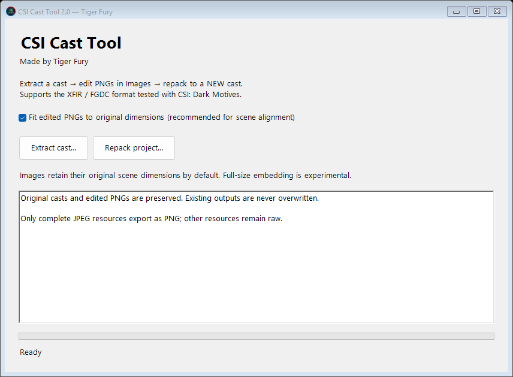

# CSI Cast Tool — C# / Windows Forms

**Made by Tiger Fury**

A Windows desktop utility for extracting and rebuilding the little-endian XFIR/FGDC compressed cast format (.cct) inspected in **CSI: Dark Motives**. Version1 was originally written in Python, Version 2 is Rewritten in C#. This is an experimental cast (.cct) editor, not a universal Director decompiler.



## Features

- Extract raw resources and complete JPEG-backed images as editable PNGs.
- Generate contact sheets to identify scenes visually.
- Automatically detect edited PNGs and embed replacements when repacking.
- Fit replacements to the original dimensions by default, preserving the existing scene geometry.
- Retain unchanged resource payloads byte-for-byte and verify the entire rebuilt payload set.
- Refuse to overwrite casts, output reports or nonempty extraction projects.
- Preserve the source cast, project original and edited images; installation remains a manual step.
- Keep the UI responsive while extracting and repacking.
- Read the earlier Python tool's `project.json` projects as well as projects created by this app.

## Use

1. Run **CSI-Cast-Tool.exe** from the Windows release ZIP. The self-contained x64 release requires no Python, Director or separately installed .NET runtime.
2. Click **Extract cast**, choose a `.cct`, and select the parent folder for a new project.
3. Browse the contact sheets and edit the matching PNG in **Images**. Keep the filename. Do not edit both the PNG and its raw resource.
4. Leave **Fit edited PNGs to original dimensions** checked. Click **Repack project**, choose `project.json`, and save to a new `.cct` filename.
5. Close the game and back up the installed cast outside its installation. Manually copy the rebuilt cast to its original filename and location. For Dark Motives Case 2: `Case_2\Art\Case_2_Art.cct`.
6. Test the scene, transitions, tools and hotspots. Restore your backup if necessary.

An output `.cct.report.json` lists replaced resource IDs, checksums and dimensions. Existing output files are refused even if the save dialog offered an overwrite confirmation; choose a new filename.

The old **loose preview folder** is not a project. Extract a fresh project first, then copy the edited PNGs into its Images folder. Actual projects from the earlier Python app are supported.

## Dimensions and limitations

The default fits edited images to their original pixel size. For example, a 1920×1080 replacement for an 800×500 image is resized to 800×500; different aspect ratios will stretch. For best results, edit at matching proportions.

Turning off Fit embeds the full-resolution image but does not update scene scripts, registration points or cast geometry. Larger images displayed oversized in our earlier experiment. This option is experimental, not an automatic high-resolution scene fix.

Only complete JPEG resources are decoded to PNG. BITD, alpha, scripts, sound and other formats stay raw. This does not recover editable Director source. Other Director archive types, executable projectors and unsupported cast structures are rejected. Transparent PNG replacements are rejected because JPEG cannot preserve transparency. JPEG encoding uses Windows' encoder at quality 98; it is not byte-identical to Pillow's encoder.

## Open in Visual Studio

Requires Windows and the **.NET 10 SDK**, plus a Visual Studio installation that supports .NET 10 with the **.NET desktop development** workload.

Open **CSI-Cast-Tool.sln**, set **CSI.CastTool** as the startup project, and build/run it. `MainForm.cs` and `MainForm.Designer.cs` hold the interface. `CSI.CastTool.Core` holds the archive/project engine; `CSI.CastTool.Checks` is the executable validation harness.

The included **Windows-x64** publish profile builds a self-contained single-file release from Visual Studio's Publish action.

No game assets, personal installation paths, NuGet API keys or Python dependencies are needed to build. All game paths are selected at runtime.

## Build, check and publish

From the repository root:

```powershell
dotnet build CSI-Cast-Tool.sln -c Release -m:1
dotnet run --project tests/CSI.CastTool.Checks -c Release --no-build
dotnet publish src/CSI.CastTool/CSI.CastTool.csproj -c Release -r win-x64 --self-contained true -p:PublishSingleFile=true -p:IncludeNativeLibrariesForSelfExtract=true -o artifacts/win-x64
```

Publishing may download Microsoft's runtime packs. The self-contained EXE is larger because it includes .NET. The source project itself has no external NuGet packages.

Optionally validate an actual cast you own (read-only; outputs go to a new temporary fixture directory):

```powershell
dotnet run --project tests/CSI.CastTool.Checks -c Release -- --cast "D:\Games\CSI-Dark Motives\Case_2\Art\Case_2_Art.cct"
```

The harness generates its own small synthetic cast with a JPEG, tests round trips and image replacement, and checks size fitting, full-size mode, conflict/alpha/tamper/path rejection and file protection. Synthetic fixtures contain no game assets. GitHub Actions builds, runs these checks and uploads a Windows release artifact.

## Validation scope

Local checks passed with synthetic fixtures and an unchanged round trip of the inspected Dark Motives Case 2 cast: 1,728 decoded resource payloads and 83 exported JPEG-backed PNGs. The previous Python-built 800×500 single-image replacement was user-tested in-game. C#-built game replacements still need user in-game testing; this port does not claim every CSI cast or game is supported.

MIT license, copyright Tiger Fury. See LICENSE and THIRD-PARTY-NOTICES.md.
